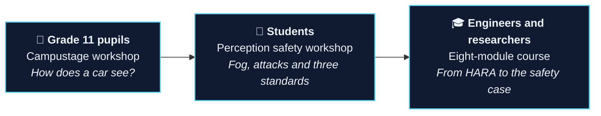

 

<!-- Add your profiles here once you send the IDs:

-->

<b><a href="#research">Research</a></b> · <b><a href="#publications">Publications</a></b> · <b><a href="#projects">Projects</a></b> · <b><a href="#teaching-and-outreach">Teaching</a></b> · <b><a href="#toolbox">Toolbox</a></b> · <b><a href="#contact">Contact</a></b>

---

### Hi, I'm Milin

I'm a PhD candidate at the **Institute for Driver Assistance and Connected Mobility (IFM), Hochschule Kempten**, supervised by Prof. Dr. Rolf Jung.

An automated vehicle has to *see* before it can drive, and today that seeing is done by neural networks that learned from data rather than following a specification. My research asks a practical question:

> **How do you show that a learned perception system is safe and secure enough to release, and keep showing it after the model is updated?**

The standards that apply (ISO 26262, ISO 21448, ISO/SAE 21434 and ISO/PAS 8800) each answer part of that question in their own terms. I work on joining them into one lifecycle and one argument, and on producing the evidence that argument needs, from hazard analysis to monitoring in the field.

---

## Research

 

My dissertation, ***Lifecycle Assurance Framework for Highly Automated Driving with AI Components in Compliance with Safety and Cybersecurity Standards (LAF-HAD)***, follows one LiDAR-based 3D object detector through six phases. For each phase it states the activities, the evidence they produce and the clause that asks for them.

<b>How each project fits the lifecycle</b> (click to expand)

 

| Phase | Question it answers | Where I work on it |
|---|---|---|
| 1 · Concept and requirements | What can go wrong, and how bad is it? | Hazard analysis (HARA) and threat analysis (TARA) for a pedestrian emergency-braking function, in my teaching material |
| 2 · Design and training | Is the data fit for purpose? | Data lifecycle in the framework |
| 3 · Verification and validation | Does the detector meet its targets, also in rain, fog or at range? | **SOTIF perception benchmark**: 14 sensor-degradation types. **[Applicability test](https://github.com/milinpatel07/lidar-performance-target-applicability)**: does a threshold still hold under a triggering condition? |
| 4 · Integration and deployment | Is the safety and security argument complete? | **[Integrated GSN argument](https://github.com/milinpatel07/Assurance-Gaps-in-an-Integrated-Safety-and-Cybersecurity-Case)** across four standards |
| 5 · Operation and monitoring | Is it still safe on the road? | **Runtime uncertainty monitor**: ensemble disagreement mapped to Monitor, Alert, Degraded, Fallback and minimal-risk manoeuvre |
| 6 · Modification and re-assurance | Does the argument survive an over-the-air update? | Re-assurance after model updates, an open gap between the standards |

---

## Publications

**2026**

- **Integrating Cybersecurity Into the AI Safety Assurance Argument: A GSN Pattern for AI-Based Perception Components in Highly Automated Driving.** 
  M. Patel, R. Jung. *SAFECOMP 2026 Workshops (WAISE)*, LNCS, Springer, pp. 763–779. 
  [`DOI`](https://doi.org/10.1007/978-3-032-35506-5_55) · [`Website`](https://milinpatel07.github.io/Assurance-Gaps-in-an-Integrated-Safety-and-Cybersecurity-Case/) · [`Code`](https://github.com/milinpatel07/Assurance-Gaps-in-an-Integrated-Safety-and-Cybersecurity-Case) · [`Archive`](https://doi.org/10.5281/zenodo.22091825)
- **Operational Safety and Cybersecurity Assurance of AI-Based Perception in Highly Automated Driving.** 
  M. Patel, R. Jung. *SAFECOMP 2026*, to appear.

**Submitted**

- **Uncertainty Evaluation to Support Safety of the Intended Functionality Analysis for Determining the Applicability of Performance Targets Across Triggering Conditions in ML-Based LiDAR Object Detection.** 
  M. Patel, R. Jung. Submitted, 2026. 
  [`Story`](https://milinpatel07.github.io/lidar-performance-target-applicability/story.html) · [`Code`](https://github.com/milinpatel07/lidar-performance-target-applicability) · [`Archive`](https://doi.org/10.5281/zenodo.23495356)

<b>Earlier work, 2024 to 2025</b>

 

- **A Systematic Literature Review on Safety of the Intended Functionality for Automated Driving Systems.** 
  M. Patel, R. Jung, M. Khatun. *SAE Technical Paper* 2025-01-5030, 2025. [`DOI`](https://doi.org/10.4271/2025-01-5030)
- **Uncertainty Representation in a SOTIF-Related Use Case with Dempster–Shafer Theory for LiDAR Sensor-Based Object Detection.** 
  M. Patel, R. Jung. *arXiv* 2503.02087, 2025. [`arXiv`](https://arxiv.org/abs/2503.02087)
- **Simulation-Based Performance Evaluation of 3D Object Detection Methods with Deep Learning for a LiDAR Point Cloud Dataset in a SOTIF-related Use Case.** 
  M. Patel, R. Jung. *Proceedings of the 10th International Conference on Vehicle Technology and Intelligent Transport Systems (VEHITS)*, pp. 415–426, 2024.

---

## Projects

<table>
<tr>
<td width="50%" valign="top">
<h3>🧩 Assurance gaps</h3>

<b>One GSN argument across four standards</b>

Combines ISO 26262, ISO 21448, ISO/SAE 21434 and ISO/PAS 8800 claims for one AI perception component and shows where the standards leave the engineer to decide.

<a href="https://milinpatel07.github.io/Assurance-Gaps-in-an-Integrated-Safety-and-Cybersecurity-Case/argument.html"><b>Explore the argument →</b></a> <a href="https://github.com/milinpatel07/Assurance-Gaps-in-an-Integrated-Safety-and-Cybersecurity-Case">Repository</a> · GSN · safety case · Python

</td>
<td width="50%" valign="top">
<h3>🎯 Performance-target applicability</h3>

<b>Does a threshold still hold in the rain?</b>

A statistical test for ISO 21448: keep an uncertainty threshold chosen in one condition and check, with recorded data, whether it still meets its target under a triggering condition.

<a href="https://milinpatel07.github.io/lidar-performance-target-applicability/story.html"><b>The idea in two minutes →</b></a> <a href="https://github.com/milinpatel07/lidar-performance-target-applicability">Repository</a> · SOTIF · LiDAR · statistics

</td>
</tr>
<tr>
<td width="50%" valign="top">
<h3>🏫 Sicher durch Zufall?</h3>

<b>A school workshop for grade 11 (in German)</b>

Pupils count the people in a street scene, then watch an AI do it, lose them in fog and get fooled by an attack. No code needed: sliders and buttons in Colab.

<a href="https://github.com/milinpatel07/campustage-2026-sicher-durch-zufall"><b>Open the workshop →</b></a> Campustage 2026 · Jupyter · outreach

</td>
<td width="50%" valign="top">
<h3>📄 Document chat</h3>

<b>Answers only from your own documents</b>

Ask questions about your PDFs and get answers with page references and the exact passages they came from. If the documents don't contain the answer, it says so.

<a href="https://github.com/milinpatel07/doc-chat"><b>See the tool →</b></a> RAG · Streamlit · ChromaDB · for any researcher

</td>
</tr>
</table>

<b>In preparation, not public yet</b>

 

| Project | What it is |
|---|---|
| 🎓 **Autonomous Driving: AI Safety and Security** | An open course in eight modules, from perception to the safety case, built around one pedestrian emergency-braking example, with notebooks that run on a CPU |
| 🔬 **AI Perception Safety Workshop** | Hands-on: a real detector loses pedestrians in fog and under attack, and you work out which standard applies to each cause |
| 📡 **Runtime Uncertainty Monitoring** | Deep ensembles of a LiDAR detector; their disagreement becomes a runtime signal with a graded response |
| 🌫️ **SOTIF Perception Benchmark** | 3D detection under 14 types of sensor degradation, with each failure placed in one of the four ISO 21448 areas |

---

## Teaching and outreach

The same story at three depths: a detector that misses a pedestrian, why it happened, and what the standards ask you to do about it.

---

## Toolbox

**Standards and methods**

**Code and data**

---

## Contact

I'm glad to talk about AI safety assurance, SOTIF, safety cases, runtime monitoring, or teaching these topics. Collaborations, industry questions and student projects are all welcome.

- 🏛️ Institute for Driver Assistance and Connected Mobility (IFM), Hochschule Kempten
- 💬 Open an issue on any of my public repositories

The animations on this page are plain SVG and stop if your system asks for reduced motion.

