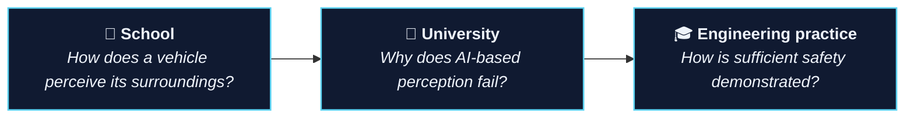

 

 

<b><a href="#research">Research</a></b> · <b><a href="#publications">Publications</a></b> · <b><a href="#projects">Projects</a></b> · <b><a href="#education">Education</a></b> · <b><a href="#toolbox">Toolbox</a></b> · <b><a href="#contact">Contact</a></b>

---

### Safety and security of AI-based perception

Automated driving systems depend on AI-based perception to detect pedestrians, vehicles and the road layout. These AI components learn their behaviour from data instead of following a written specification, so the established methods of safety engineering cover them only in part.

The research addresses three guiding questions, one for each stage of the lifecycle:

| | Guiding question |
|:--:|---|
| **Before release** | Is the performance of the AI-based perception sufficient, including under adverse conditions? |
| **At release** | Do the safety and cybersecurity claims combine into one consistent assurance case? |
| **After release** | Does the evidence remain valid in operation and after each update of the AI component? |

The work brings together **functional safety** (ISO 26262), **safety of the intended functionality, SOTIF** (ISO 21448), **cybersecurity** (ISO/SAE 21434) and **AI safety** (ISO/PAS 8800), and turns their requirements into evidence that engineers can produce and assessors can check.

---

## Research

 

---

## Publications

Peer-reviewed publications at international conferences and workshops on dependable systems and vehicle technology.

**Topics:** `assurance cases for AI` · `safety and cybersecurity co-engineering` · `SOTIF` · `uncertainty in LiDAR perception` · `runtime monitoring` · `standards analysis`

**Full list:** [Google Scholar](https://scholar.google.com/citations?user=2pdr8QwAAAAJ) · [ORCID](https://orcid.org/0000-0002-8357-6018) · [ResearchGate](https://www.researchgate.net/profile/Milin-Patel)

---

## Projects

<table>
<tr>
<td width="50%" valign="top">
<h3>🧩 Assurance case explorer</h3>

<b>Safety and cybersecurity in one assurance case</b>

An interactive website that presents a structured assurance case for an AI component, goal by goal, across several standards.

<a href="https://milinpatel07.github.io/Assurance-Gaps-in-an-Integrated-Safety-and-Cybersecurity-Case/"><b>Explore the assurance case →</b></a> assurance cases · GSN · Python

</td>
<td width="50%" valign="top">
<h3>🎯 Performance under triggering conditions</h3>

<b>Is the performance target still met in rain?</b>

A statistical test that checks whether AI-based perception still meets its performance target when conditions change, explained without formulas.

<a href="https://milinpatel07.github.io/lidar-performance-target-applicability/story.html"><b>Read the explanation →</b></a> SOTIF · LiDAR · statistics

</td>
</tr>
<tr>
<td width="50%" valign="top">
<h3>🏫 How does a vehicle perceive?</h3>

<b>School workshop (in German)</b>

Pupils observe an object detector in a street scene, then see it miss pedestrians in fog and fail under a manipulated image. No programming required.

<a href="https://github.com/milinpatel07/campustage-2026-sicher-durch-zufall"><b>Open the workshop →</b></a> outreach · Jupyter · Colab

</td>
<td width="50%" valign="top">
<h3>📄 Document chat</h3>

<b>Answers from uploaded documents only</b>

A research tool that answers questions from uploaded documents, with page references and the exact source passages, so every answer can be checked.

<a href="https://github.com/milinpatel07/doc-chat"><b>View the tool →</b></a> retrieval-augmented generation · Streamlit

</td>
</tr>
</table>

---

## Education

Teaching material in which learners run a real object detector, observe where it fails, and work out the engineering response.

---

## Toolbox

**Standards and methods**

**Software and data**

---

## Contact

Open to research collaboration, industry exchange and student projects on AI safety, SOTIF and assurance cases.

[LinkedIn](https://www.linkedin.com/in/milinpatel1996/) · [Google Scholar](https://scholar.google.com/citations?user=2pdr8QwAAAAJ) · [ORCID](https://orcid.org/0000-0002-8357-6018) · [ResearchGate](https://www.researchgate.net/profile/Milin-Patel)

Animations are plain SVG and pause when reduced motion is requested.

