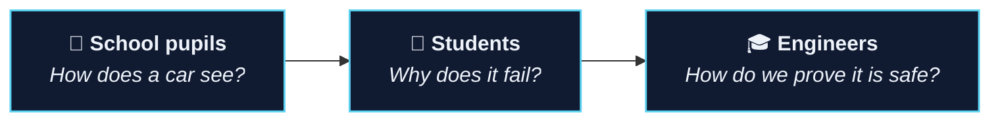

 

<!-- Profile buttons: send me the links and I'll fill them in.

-->

<b><a href="#research">Research</a></b> · <b><a href="#publications">Publications</a></b> · <b><a href="#projects">Projects</a></b> · <b><a href="#teaching">Teaching</a></b> · <b><a href="#toolbox">Toolbox</a></b> · <b><a href="#contact">Contact</a></b>

---

### Hi, I'm Milin 👋

I'm a PhD researcher working on **automated driving**. Cars increasingly rely on AI to see the road, and AI learns from data instead of following a written specification. That makes it powerful, and it also makes it hard to prove safe.

> **My work is about one question: how do we earn justified trust in AI that drives?**

I bring together **functional safety, safety of the intended functionality (SOTIF), cybersecurity and AI safety** so they work as one, and I build tools that turn those ideas into evidence engineers can use.

---

## Research

 

<b>What I look at in each phase</b> (click to expand)

 

| Phase | The question | My angle |
|---|---|---|
| Concept and requirements | What can go wrong? | Hazards, threats and the limits of what a sensor or model can do |
| Data and design | Is the data fit for purpose? | Data as a safety artefact, not just training material |
| Verification and validation | Does it meet its targets? | Testing perception under bad weather, noise and edge cases |
| Release | Is the case convincing? | Structured assurance arguments that cover safety and security together |
| Operation | Is it still safe out there? | Runtime monitoring and uncertainty as early warning signals |
| Updates | Does it hold after a change? | Keeping the evidence valid when models are retrained or updated |

---

## Publications

I publish at international conferences and workshops on **dependable systems** and **vehicle technology**. Recent topics:

`assurance cases for AI` · `safety and security co-engineering` · `SOTIF` · `uncertainty in LiDAR perception` · `runtime monitoring` · `standards analysis`
---

## Projects

<table>
<tr>
<td width="50%" valign="top">
<h3>🧩 Assurance explorer</h3>

<b>One argument across several standards</b>

An interactive website that walks through a structured safety and security argument for an AI component, step by step.

<a href="https://milinpatel07.github.io/Assurance-Gaps-in-an-Integrated-Safety-and-Cybersecurity-Case/"><b>Explore →</b></a> assurance cases · GSN · Python

</td>
<td width="50%" valign="top">
<h3>🎯 Performance under conditions</h3>

<b>Does it still work in the rain?</b>

A statistical way to check whether a perception system still meets its targets when conditions change, explained without formulas.

<a href="https://milinpatel07.github.io/lidar-performance-target-applicability/story.html"><b>Read the story →</b></a> SOTIF · LiDAR · statistics

</td>
</tr>
<tr>
<td width="50%" valign="top">
<h3>🏫 How does a car see?</h3>

<b>A school workshop (in German)</b>

Pupils watch an AI detect people in a street scene, then see it fail in fog and get fooled by an attack. No code needed.

<a href="https://github.com/milinpatel07/campustage-2026-sicher-durch-zufall"><b>Open the workshop →</b></a> outreach · Jupyter · Colab

</td>
<td width="50%" valign="top">
<h3>📄 Document chat</h3>

<b>Ask your own documents</b>

Answers questions only from the files you upload, with page references and the exact passages, so every answer can be checked.

<a href="https://github.com/milinpatel07/doc-chat"><b>See the tool →</b></a> RAG · Streamlit · for any researcher

</td>
</tr>
</table>

---

## Teaching

I like making safety engineering tangible: you run a real detector, watch it fail, and then work out what a responsible engineer would do about it.

---

## Toolbox

**Standards and methods**

**Code and data**

---

## Contact

Happy to talk about AI safety, SOTIF, assurance cases or teaching these topics. Research collaborations, industry questions and student projects are all welcome.

The animations on this page are plain SVG and pause if your system asks for reduced motion.

